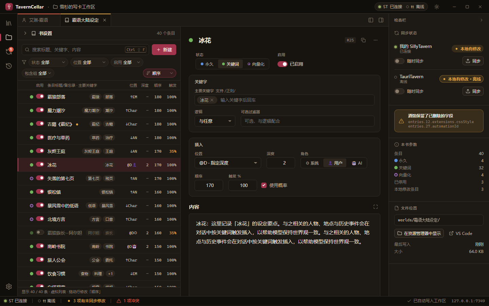
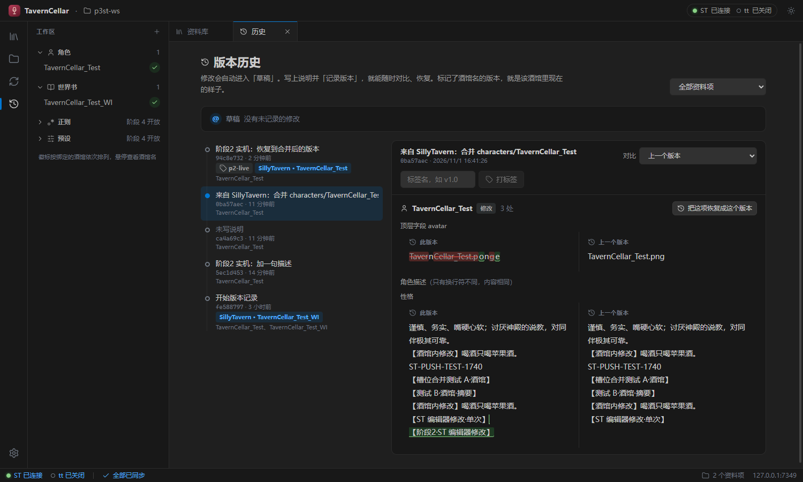

# TavernCellar 酒窖

把酒馆（SillyTavern / TauriTavern）里的 **角色卡、世界书、正则、预设** 搬进电脑上的一个文件夹，用 **Cellar Studio** 舒舒服服地编辑，改完一键同步回酒馆。每一次修改都有版本记录，随时可以对比、回退。



## 能做什么

- **取出与同步**：在「资料库」里把酒馆中的卡、书、正则、预设取出到工作区；改完点「同步」写回酒馆，也可以开「随时同步」，改一下酒馆里就跟着变。
- **好用的编辑器**：世界书条目表（分组、拖动排序、批量修改）、角色卡表单、预设提示词，支持撤回 / 重做。也能用 VS Code 等编辑器直接改文件夹里的文件。
- **版本历史**：随手「记录版本」，可以对比任意两个版本、恢复旧版本、打标签，还能把某个版本推送到指定酒馆。
- **预览**：看看酒馆最后真正会发给 AI 的内容，世界书哪些条目被触发一目了然。
- **预设工坊**：两个预设的提示词并排对比，拖过去就能复制。
- **不会偷偷覆盖**：酒馆里和工作区里都改过时，会弹出对比页让你选择，而不是悄悄覆盖。
- **同时管理多个酒馆**：SillyTavern 和 TauriTavern 可以一起连，同一张卡可以同步到多个酒馆。



## 安装

TavernCellar 分两部分，按需要装：

| 部分 | 作用 | 什么时候需要 |
|---|---|---|
| **Cellar Studio** | 编辑器本体（含伴侣程序） | 必装，下面两种方式选一种 |
| **Cellar Link** | 酒馆里的小插件，让 Studio 能和正在运行的酒馆实时同步 | 想在酒馆开着的时候同步时安装 |

### Cellar Studio：二选一

**方式一：独立程序（推荐）**

到 [Releases](https://github.com/qianzhuowo/TavernCellar/releases) 下载：

- `CellarStudio-Setup-<版本>.exe`：安装版，双击安装，之后会自动提示更新。
- `CellarStudio-Portable-<版本>.exe`：便携版，免安装，双击就能用。

**方式二：随酒馆插件一起用**

先按下面的方法在酒馆里装好 Cellar Link，然后打开插件文件夹（`SillyTavern\public\scripts\extensions\third-party\TavernCellar`），双击 **`Start Cellar Studio.bat`**，浏览器会自动打开 Studio。

> 这种方式需要电脑上装有 [Node.js](https://nodejs.org/) 20 或更新版本；第一次运行会自动下载依赖，稍等一会儿。关掉那个黑色命令行窗口，Studio 就停止了。

### Cellar Link：酒馆插件（可选）

在 SillyTavern 或 TauriTavern 里打开 **扩展 → 安装扩展**，填入：

```
https://github.com/qianzhuowo/TavernCellar.git
```

装好后，只要 Studio 开着，酒馆就会自动连上，不需要填令牌。

### 不装插件也能用

酒馆没装插件、或者酒馆没开的时候，也可以直接读写酒馆的文件：

1. 打开 Studio 的 **设置 → 连接**，给酒馆点「设置目录…」，填 SillyTavern 的安装目录，或 TauriTavern 的数据目录。
2. 把「酒馆未运行时」改成 **不开酒馆也同步**。

这样酒馆关着的时候，同步会直接写进酒馆的数据文件夹（写之前会先备份原文件）。酒馆开着时请用 Cellar Link 同步，免得和酒馆自己的保存互相覆盖。

## 使用流程

1. **第一次打开**：跟着启动向导选一个工作区文件夹（默认是安装目录下的 `workspace`，升级、卸载都不会删除）。
2. **取出**：点左侧「资料库」，选一张角色卡或一本世界书，点「取出」，它就出现在「工作区」里了。
3. **编辑**：在工作区里点开它，直接改。改动会自动保存到工作区。
4. **同步**：点右侧检查栏里的「同步」写回酒馆；或者打开「随时同步」，以后改了就自动写回。
5. **记录版本**：在「历史」里写一句改了什么，点「记录版本」。以后想回到这个状态，点一下就行。

想把工作区里的东西放进另一个酒馆（比如从 SillyTavern 搬到 TauriTavern），在右侧检查栏点「发布到 …」就行。

## 常见问题

- **支持哪些酒馆？** 已在 SillyTavern 1.15.0 和 TauriTavern 2.4.0 上实际测试过，其他版本大多也能用；遇到问题欢迎在 Issues 里反馈。
- **Studio 显示「未连接」？** 确认酒馆已打开、Cellar Link 已启用，并且 Studio 正在运行。连接大约在 1 分钟内自动建立。
- **工作区在哪？** 设置 → 工作区，可以查看和更换。工作区就是普通的文件夹，可以备份，也可以用 VS Code 打开。
- **历史越来越大？** 设置 → 版本历史，点「压缩历史」，或者打开自动清理。

## 开发者

- [开发与发布流程](docs/development.md)
- [开发路线](docs/ROADMAP.md) · [架构](docs/architecture.md) · [连接协议](docs/protocol.md) · [工作区格式](docs/workspace-format.md) · [版本管理](docs/versioning.md)

## 许可证

[GNU AGPL v3.0](LICENSE)
